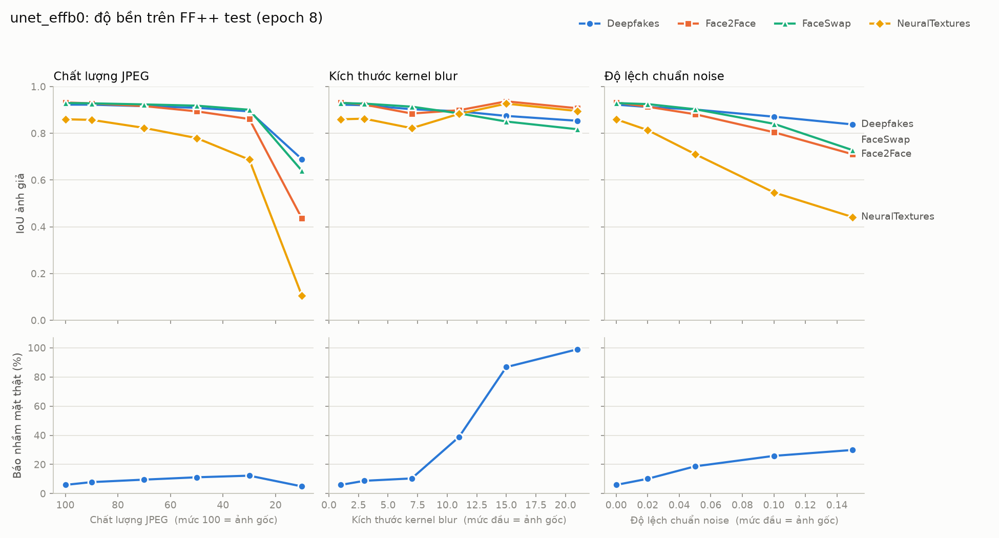
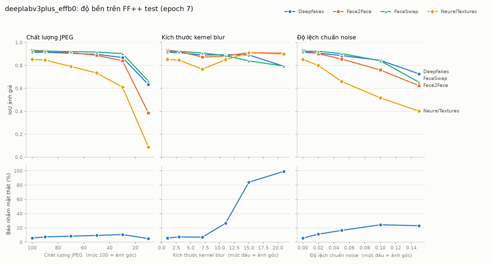
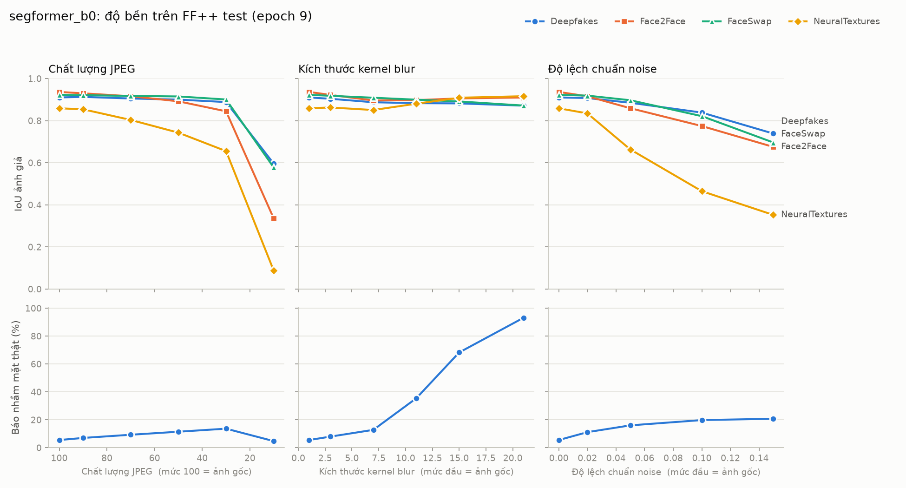

# Kế hoạch đồ án: Định vị vùng giả mạo deepfake trên khuôn mặt bằng pixel segmentation

Cập nhật: 11/10/2026 · Thời gian thực hiện: 12/10/2026 – 24/01/2027 (15 tuần)

Đề tài giải bài toán **pixel segmentation**: với mỗi ảnh mặt cắt từ frame video, mô hình dự đoán cho **từng pixel** xác suất pixel đó thuộc vùng bị chỉnh sửa. Đề tài so sánh 3 kiến trúc là U-Net, DeepLabV3+ và SegFormer-B0. Dữ liệu train và test là FaceForensics++ (FF++) c23 có mask, còn DeepFakeDetection (DFD) dùng để kiểm tra chéo. Theo yêu cầu của giảng viên, đề tài **không làm phân loại thật/giả** cho cả video.

## 1. Bài toán ở mức pixel

| | Mô tả |
| --- | --- |
| Đầu vào | Ảnh mặt RGB 256×256, cắt từ một frame video |
| Đầu ra | Bản đồ xác suất 256×256. Lấy ngưỡng 0,5 được mask nhị phân, trong đó 1 là pixel bị chỉnh sửa |
| Nhãn | Mask chính thức của FF++/DFD, cắt cùng khung với ảnh. Mặt thật dùng mask đen toàn bộ |
| Loss | Dice + BCE. Dice bù cho việc pixel giả ít hơn pixel thật, BCE giữ cho mặt thật được dự đoán đúng là đen |

Hình dạng mask khác nhau theo phương pháp giả, nên khi phân tích kết quả cần nêu rõ:

| Phương pháp | Loại giả | Hình dạng mask |
| --- | --- | --- |
| Deepfakes | Thay mặt (autoencoder) | Hình chữ nhật quanh mặt |
| FaceSwap | Thay mặt (đồ hoạ) | Theo viền mặt, chừa lỗ ở miệng |
| Face2Face | Tái hiện biểu cảm | Ảnh render 3D xám có bóng đổ, phủ gần cả mặt |
| NeuralTextures | Tái hiện biểu cảm (neural rendering) | Ảnh render xám, phủ gần cả mặt |
| DFD | Thay mặt (Google) | Gần chữ nhật quanh mặt |

Trên khung hình gốc, vùng giả chỉ chiếm khoảng 1–9% diện tích (đo trên 8 video mỗi loại). Sau khi cắt mặt, tỉ lệ vùng giả trung bình là **24%** ở Deepfakes và khoảng **32%** ở Face2Face, FaceSwap, NeuralTextures (đo trên 400 frame train mỗi loại). Như vậy, ngay cả trên ảnh giả, phần lớn pixel vẫn là pixel thật.

## 2. Dữ liệu

Chỉ dùng dữ liệu tải từ server TUM bằng script chính thức của FF++ (server EU2), mức nén c23.

| Phần | Số video | Dung lượng | Dùng để |
| --- | --- | --- | --- |
| original (youtube) | 1000 | ~8,5 GB (cùng 4 phương pháp) | Mặt thật FF++ |
| Deepfakes, Face2Face, FaceSwap, NeuralTextures | 4 × 1000 | (tính chung ở trên) | Mặt giả FF++ |
| Mask 4 phương pháp | 4 × 1000 | 44 MB / 14 GB / 15 GB / 12 GB | Nhãn pixel |
| DFD giả c23 + mask | 3068 + 3068 | 20 GB + 3,9 GB | Kiểm tra chéo |
| DFD thật (actors) c23 | 363 | 2,8 GB | Đo báo nhầm khi kiểm tra chéo |
| Bản **c40** (nén mạnh) của original, 4 phương pháp, DFD giả và thật | 5000 + 3068 + 363 | (đang tải) | Test độ bền với video nén mạnh. Dùng chung mask c23 vì cùng frame |

- **Chia tập:** dùng split chính thức của FF++ (`data/splits/{train,val,test}.json`), gồm 360/70/70 cặp, tức 720/140/140 video gốc. Mỗi cặp `[a, b]` cho ra 2 video gốc và 2 video giả mỗi phương pháp (`a_b`, `b_a`). Như vậy một người chỉ xuất hiện trong một tập, không chia ngẫu nhiên theo frame.
- Số frame sau tiền xử lý (`data/index/*.csv`):

  | Tập | Frame thật | Frame giả | Ghi chú |
  | --- | --- | --- | --- |
  | Train | 23.039 | 92.084 | 720 video mỗi nhóm |
  | Val | 4.480 | 17.851 | Bỏ Face2Face/NeuralTextures `115_939` (mask lệch) |
  | Test | 4.480 | 17.849 | Bỏ Face2Face/NeuralTextures `227_169` (mask lệch) |
  | DFD | 11.047 | 97.083 | 3068 video giả, 363 video thật |

- **DFD** không dùng để train, chỉ dùng để đo khả năng tổng quát.
- **FaceShifter** không có mask nên không dùng.
- Mỗi video gốc có 4 video giả tương ứng, nên khoảng 80% frame là giả. Vì vậy khi train cần lấy mẫu cân bằng (mục 4).

## 3. Tiền xử lý (`src/preprocess.py`)

| Bước | Cách làm |
| --- | --- |
| 1. Lấy frame | 32 frame cách đều mỗi video. Đọc video và video mask **song song từng frame**, nên chỉ số frame luôn khớp |
| 2. Phát hiện mặt | RetinaFace ResNet-50 (`batch-face`, chạy GPU), ngưỡng tin cậy 0,9. Phát hiện trên ảnh thu nhỏ về cạnh dài 960 rồi đổi khung về ảnh gốc |
| 3. Chọn mặt | Video thật: mặt lớn nhất. Video giả: mặt **chứa nhiều vùng mask nhất**, vì cảnh DFD có thể có 2 người mà người lớn hơn không bị giả |
| 4. Cắt | Khung vuông có cạnh bằng 1,3 lần cạnh dài của mặt. Phần ra ngoài ảnh tô đen. Cắt ảnh và mask bằng **cùng một khung** |
| 5. Nhị phân mask | Ngưỡng **> 10**, lưu dạng 0/255. Mask Face2Face/FaceSwap/NeuralTextures là ảnh xám có bóng đổ: ngưỡng 127 làm mất 10–20% vùng giả |
| 6. Resize | 256×256. Ảnh dùng INTER_AREA khi thu nhỏ, INTER_LINEAR khi phóng to. Mask dùng INTER_NEAREST để biên không bị nhoè |
| 7. Lưu | PNG (không thêm nhiễu nén) vào `data/faces/<nhóm>/{frames,masks}/<video>/<chỉ số frame>.png`. Nhật ký mỗi video ghi vào `data/faces/log.jsonl` |

Kết quả trên c23: 8.431 video cho khoảng 268 nghìn cặp ảnh và mask, chạy khoảng 3,5 tiếng (3 tiến trình trên RTX 3050). Số frame không tìm thấy mặt: FF++ dưới 0,02%; DFD giả 0,7%; DFD thật 4,9% (cảnh đi bộ, người ở xa hoặc quay lưng).

Lỗi trong mask chính thức đã phát hiện và xử lý:

| Vấn đề | Video | Xử lý |
| --- | --- | --- |
| Mask nằm lệch khỏi mặt (trên phông nền), trọn video | Face2Face và NeuralTextures của `115_939` (val) và `227_169` (test) | `build_index.py` bỏ mọi frame giả có mask trống: train 66, val 65, test 71, DFD 40 frame |
| Mask trống ở vài frame lẻ | Khoảng 27 video FaceSwap (1–5 frame, riêng `604_703` có 25 frame), 40 video DFD (1 frame, chủ yếu cảnh `kitchen_pan` và đi bộ), Deepfakes `024_073` (1 frame) | Như trên |
| Mask ngắn hơn video (khớp từ frame đầu) | 118/3068 video DFD | Chỉ lấy 32 frame trong đoạn có mask |

## 4. Pipeline huấn luyện

| Thành phần | File | Nội dung |
| --- | --- | --- |
| Danh sách mẫu | `src/build_index.py` | `data/index/{train,val,test,dfd}.csv`. Mỗi dòng là một frame: đường dẫn ảnh, mask, phương pháp, video, nhãn |
| Dataset | `src/dataset.py` | Trả về ảnh (3,256,256) và mask (1,256,256) 0/1. Frame thật dùng mask đen |
| Augment | `src/dataset.py` | Lật ngang, xoay ±10°, scale 0,9–1,1, dịch ±5%: áp cho **cả ảnh và mask**. Nén JPEG 40–100, blur, noise, độ sáng: **chỉ áp cho ảnh** |
| Cân bằng | `balanced_sampler` | Mỗi batch trung bình **50% frame thật, 50% frame giả**. Đã kiểm tra: 49% qua 50 batch |
| Train | `src/train.py` | AMP float16, AdamW, OneCycleLR, batch 16, 10 epoch. Lưu `last.pt` mỗi epoch, log TensorBoard |
| Chọn checkpoint | `src/train.py` | `best.pt` theo điểm **(IoU ảnh giả + (1 − tỉ lệ báo nhầm)) / 2** |
| Đánh giá | `src/evaluate.py` | Chạy trên val, test hoặc dfd. In bảng theo từng phương pháp, lưu `eval_<split>.json` |

Không chọn checkpoint chỉ theo IoU. Lần chạy thử (1 epoch, 5% dữ liệu) cho IoU ảnh giả 0,78 nhưng **82% mặt thật bị báo nhầm**. Mask Face2Face/NeuralTextures phủ gần cả mặt, nên một mô hình chỉ biết "tô khuôn mặt" vẫn đạt IoU cao.

## 5. Mô hình

| Mô hình | Ý tưởng | Encoder (pretrained ImageNet) | Tham số | Learning rate |
| --- | --- | --- | --- | --- |
| U-Net | Encoder-decoder, skip connection giữ chi tiết biên | EfficientNet-B0 | 6,3M | 3e-4 |
| DeepLabV3+ | Tích chập giãn (ASPP) nắm bối cảnh nhiều tỉ lệ | EfficientNet-B0 | 4,9M | 3e-4 |
| SegFormer-B0 | Transformer nhẹ, quan hệ toàn cục giữa các vùng | MiT-B0 (`nvidia/mit-b0`) | 3,7M | 1e-4 |

Cả ba dùng cùng dữ liệu, ảnh 256×256, loss, số epoch và cách chọn checkpoint, để so sánh công bằng. Cấu hình nằm trong `configs/{unet,deeplabv3plus,segformer}.yaml`. Thời gian thực tế: U-Net mất khoảng 18 phút mỗi epoch, 10 epoch khoảng 3 tiếng trên RTX 3050 4 GB.

## 6. Đánh giá ở mức pixel (`src/metrics.py`)

| Chỉ số | Cách tính | Ý nghĩa |
| --- | --- | --- |
| IoU | Trung bình theo ảnh giả: giao / hợp của mask dự đoán và mask thật | Chỉ số chính |
| Dice | Trung bình theo ảnh giả: 2 × giao / tổng diện tích | Thường dùng trong paper |
| Pixel Precision, Recall, F1 | Cộng dồn mọi pixel của ảnh giả | Cho biết mô hình tô thừa hay tô thiếu |
| Pixel-AUC | 256 pixel ngẫu nhiên mỗi ảnh, không phụ thuộc ngưỡng | So sánh 3 mô hình |
| Tỉ lệ báo nhầm | Phần trăm ảnh mặt thật có vùng dự đoán giả lớn hơn 1% diện tích | IoU không đo được trên mask đen |

Báo cáo các bảng sau:
1. FF++ test, từng phương pháp.
2. DFD (kiểm tra chéo).
3. Độ bền: mô hình train trên c23, test trên **c40** (cắt mặt bằng cùng `preprocess.py`, dùng mask c23), và trên ảnh c23 bị nén JPEG nhiều mức, blur, noise.

## 7. Lệnh chạy

```
# 1. Tải dữ liệu (tự chờ khi server TUM sập)
powershell -ExecutionPolicy Bypass -File download_all.ps1
python watch_progress.py

# 2. Tiền xử lý: cắt mặt và mask
.venv\Scripts\python src/preprocess.py

# 3. Danh sách mẫu và kiểm tra dữ liệu
.venv\Scripts\python src/build_index.py
.venv\Scripts\python src/check_data.py --n 200

# 4. Train (thử nhanh trước bằng --fraction 0.05 --epochs 1)
.venv\Scripts\python src/train.py --config configs/unet.yaml
tensorboard --logdir runs

# 5. Đánh giá
.venv\Scripts\python src/evaluate.py runs/unet_effb0/best.pt --split test
.venv\Scripts\python src/evaluate.py runs/unet_effb0/best.pt --split dfd
.venv\Scripts\python src/evaluate.py runs/unet_effb0/best.pt --split test --compression c40

# 6. Độ bền JPEG/blur/noise (bảng + biểu đồ trong runs/<run>/robustness/)
.venv\Scripts\python src/robustness.py runs/unet_effb0/best.pt

# 7. Hình minh hoạ mask dự đoán và mask thật (runs/<run>/figures/)
.venv\Scripts\python src/visualize.py runs/unet_effb0/best.pt --split test --mode random
.venv\Scripts\python src/visualize.py runs/unet_effb0/best.pt --split test --mode worst

# 8. Phân tích lỗi theo vị trí frame và cặp diễn viên DFD (runs/analysis_<split>.md)
.venv\Scripts\python src/analyze.py runs/unet_effb0/best.pt runs/deeplabv3plus_effb0/best.pt runs/segformer_b0/best.pt --split dfd

# 9. Demo Gradio (mở http://127.0.0.1:7860)
.venv\Scripts\python src/demo.py
```
Khi GPU đang bận train, thêm `--cpu` vào lệnh 6 và 7 (chậm hơn nhiều, nên dùng kèm `--fraction`).

**Train trên Kaggle** (khi muốn rảnh máy nhà): đóng gói train/val/test bằng
`src/pack_kaggle.py --user <tên Kaggle>` (khoảng 12 GB), tải lên một Kaggle Dataset **riêng tư**
(giấy phép FF++ không cho chia sẻ), rồi chạy `kaggle/train_kaggle.ipynb`. Notebook clone code từ GitHub, train
vào `/kaggle/working/runs/` và đánh giá trên test. Tải `best.pt` về `runs/<tên run>/` để chạy
DFD, c40, độ bền và hình minh hoạ ở máy nhà (`evaluate.py` tự đổi về `data/faces`).

## 8. Lịch thực hiện

| Tuần | Thời gian | Công việc | Đầu ra |
| --- | --- | --- | --- |
| 1 | 12/10 – 18/10 | Tải dữ liệu TUM; tiền xử lý RetinaFace; kiểm tra frame/mask | `data/faces/` hoàn chỉnh |
| 2 | 19/10 – 25/10 | Index, Dataset, augment, lấy mẫu cân bằng, metrics, vòng train/eval; chạy thử 5% dữ liệu | Pipeline chạy được |
| 3 | 26/10 – 01/11 | Train U-Net EfficientNet-B0 | Trọng số U-Net |
| 4 | 02/11 – 08/11 | Đánh giá U-Net: FF++ test từng phương pháp, DFD, tỉ lệ báo nhầm | Bảng kết quả U-Net |
| 5 | 09/11 – 15/11 | Train DeepLabV3+ cùng cấu hình | Trọng số DeepLabV3+ |
| 6 | 16/11 – 22/11 | Đánh giá như tuần 4 | Bảng kết quả DeepLabV3+ |
| 7 | 23/11 – 29/11 | Test độ bền trên c40 và JPEG/blur/noise cho 2 mô hình; dự phòng trễ | Bảng độ bền |
| 8 | 30/11 – 06/12 | Giữa kỳ: so sánh U-Net và DeepLabV3+, trình bày tiến độ | Báo cáo giữa kỳ |
| 9 | 07/12 – 13/12 | Train SegFormer-B0 | Trọng số SegFormer |
| 10 | 14/12 – 20/12 | Đánh giá SegFormer, kể cả độ bền | Bảng kết quả SegFormer |
| 11 | 21/12 – 27/12 | So sánh 3 kiến trúc; phương pháp nào khó định vị nhất; hình mask dự đoán và mask thật; ca sai | Bảng so sánh, hình minh hoạ |
| 12 | 28/12 – 03/01 | Demo Gradio: RetinaFace cắt mặt **giống lúc train**, dự đoán mask, dán ngược lên video, biểu đồ diện tích vùng giả theo thời gian | Demo chạy được |
| 13 | 04/01 – 10/01 | Viết chương 1–3: tổng quan, cơ sở lý thuyết segmentation, dữ liệu và phương pháp | Bản nháp chương 1–3 |
| 14 | 11/01 – 17/01 | Viết chương 4–5: thực nghiệm, kết luận; dọn code, viết README | Báo cáo và mã nguồn hoàn chỉnh |
| 15 | 18/01 – 24/01 | Slide, video demo dự phòng, tập trình bày | Slide và bản trình bày |

Nếu chậm tiến độ: dùng tuần 7 để bù trước. Nếu vẫn trễ thì bỏ SegFormer và so sánh 2 kiến trúc CNN. Phần train có thể chuyển lên Kaggle (GPU T4/P100) để nhanh hơn.

## 9. Kết quả

Cả ba mô hình train trên FF++ c23, 10 epoch, cùng dữ liệu, augment, loss và tiêu chí chọn `best.pt`; chỉ khác learning rate và weight decay theo config.

| Mô hình | `best.pt` | Thời gian train (RTX 3050 4 GB) |
| --- | --- | --- |
| U-Net (EfficientNet-B0) | epoch 8 | khoảng 3 tiếng |
| DeepLabV3+ (EfficientNet-B0) | epoch 7 | khoảng 2,6 tiếng |
| SegFormer-B0 (MiT-B0) | epoch 9 | khoảng 4 tiếng |

### 9.1. Tổng hợp trên 3 tập test

| Tập test | Mô hình | IoU | Dice | Precision | Recall | F1 | Pixel-AUC | Báo nhầm mặt thật |
| --- | --- | --- | --- | --- | --- | --- | --- | --- |
| FF++ c23 | U-Net | **0,911** | **0,937** | 0,975 | **0,934** | **0,954** | 0,996 | 6,0% |
| FF++ c23 | DeepLabV3+ | 0,906 | 0,932 | **0,978** | 0,926 | 0,951 | **0,997** | 5,9% |
| FF++ c23 | SegFormer-B0 | 0,907 | 0,935 | 0,973 | 0,932 | 0,952 | **0,997** | **5,5%** |
| FF++ c40 | U-Net | **0,606** | **0,638** | **0,961** | **0,617** | **0,752** | **0,972** | 14,5% |
| FF++ c40 | DeepLabV3+ | 0,568 | 0,599 | **0,961** | 0,574 | 0,719 | 0,966 | 13,3% |
| FF++ c40 | SegFormer-B0 | 0,522 | 0,553 | 0,955 | 0,533 | 0,684 | 0,964 | **11,0%** |
| DFD (kiểm tra chéo) | U-Net | **0,560** | **0,643** | 0,737 | **0,749** | **0,743** | **0,951** | 20,4% |
| DFD (kiểm tra chéo) | DeepLabV3+ | 0,533 | 0,612 | **0,741** | 0,712 | 0,726 | 0,947 | **17,7%** |
| DFD (kiểm tra chéo) | SegFormer-B0 | 0,524 | 0,609 | 0,714 | 0,727 | 0,720 | 0,946 | 20,6% |

### 9.2. IoU theo phương pháp giả (FF++ test)

| Phương pháp | U-Net c23 | DeepLabV3+ c23 | SegFormer c23 | U-Net c40 | DeepLabV3+ c40 | SegFormer c40 |
| --- | --- | --- | --- | --- | --- | --- |
| Deepfakes | **0,923** | 0,915 | 0,910 | **0,798** | 0,767 | 0,725 |
| Face2Face | 0,932 | 0,932 | **0,936** | **0,513** | 0,444 | 0,398 |
| FaceSwap | **0,930** | 0,925 | 0,923 | **0,779** | 0,760 | 0,745 |
| NeuralTextures | **0,860** | 0,853 | 0,859 | **0,332** | 0,299 | 0,216 |

### 9.3. Độ bền với JPEG, blur, noise (FF++ test c23, `src/robustness.py`)

| Làm hỏng | IoU U-Net | IoU DeepLabV3+ | IoU SegFormer | Báo nhầm U-Net | Báo nhầm DeepLabV3+ | Báo nhầm SegFormer |
| --- | --- | --- | --- | --- | --- | --- |
| Ảnh gốc | 0,911 | 0,906 | 0,907 | 6,0% | 5,8% | 5,5% |
| JPEG 50 | **0,875** | 0,859 | 0,863 | 11,2% | **9,5%** | 11,5% |
| JPEG 30 | **0,836** | 0,806 | 0,822 | 12,3% | **10,7%** | 13,7% |
| JPEG 10 | **0,469** | 0,444 | 0,400 | 4,9% | 5,1% | 4,7% |
| Blur kernel 7 | 0,881 | 0,860 | **0,886** | 10,4% | **7,1%** | 12,8% |
| Blur kernel 11 | 0,890 | 0,878 | 0,890 | 38,8% | **26,5%** | 35,4% |
| Blur kernel 15 | 0,897 | 0,888 | 0,897 | 86,8% | 84,0% | **68,3%** |
| Blur kernel 21 | 0,869 | 0,848 | **0,892** | 99,0% | 99,1% | **93,2%** |
| Noise 0,05 | **0,850** | 0,827 | 0,826 | 18,7% | 16,5% | **16,0%** |
| Noise 0,15 | **0,680** | 0,601 | 0,616 | 29,9% | 23,1% | **20,8%** |

Bảng đầy đủ theo từng phương pháp nằm ở `runs/<run>/robustness/robustness.md`.







### 9.4. Hình minh hoạ và ca sai (`src/visualize.py`)

Hình nằm ở `runs/<run>/figures/` và không đưa lên git, vì chứa khuôn mặt trong dữ liệu FF++ (giấy phép không cho chia sẻ công khai). Mỗi hình có các cột: ảnh, mask thật, xác suất dự đoán, sai số (xanh dương là đúng, cam là tô thừa, xanh ngọc là bỏ sót).

| File | Nội dung |
| --- | --- |
| `test_random_<phương pháp>.png` | 6 ảnh ngẫu nhiên mỗi phương pháp |
| `test_worst_<phương pháp>.png` | 6 ca IoU thấp nhất, mỗi video một frame |
| `test_worst_original.png` | Mặt thật bị báo nhầm nhiều nhất |
| `dfd_worst_DFD.png`, `dfd_worst_actors.png` | Ca sai nhiều nhất khi kiểm tra chéo |

### 9.5. Nhận xét

- **Ba kiến trúc ngang nhau trên dữ liệu cùng phân phối.** Trên FF++ c23, IoU nằm trong khoảng 0,906–0,911 (chênh 0,5 điểm) và báo nhầm 5,5–6,0%. SegFormer-B0 báo nhầm ít nhất (5,5%) dù ít tham số nhất. NeuralTextures khó nhất với cả ba mô hình (IoU khoảng 0,85–0,86) vì chỉ sửa tinh vi vùng biểu cảm.
- **U-Net bền nhất khi ảnh bị nén hoặc nhiễu; SegFormer kém nhất khi nén.** Trên c40, IoU giảm theo thứ tự U-Net 0,606 > DeepLabV3+ 0,568 > SegFormer 0,522. NeuralTextures ở c40 chỉ còn 0,216 với SegFormer. U-Net cũng có IoU cao nhất ở mọi mức JPEG và ở noise từ 0,05 trở lên. Một giải thích hợp lý là skip connection của U-Net giữ chi tiết ở độ phân giải cao, còn SegFormer dự đoán ở 1/4 độ phân giải rồi phóng to; giả thuyết này cần kiểm chứng thêm.
- **Đổi lại, SegFormer báo nhầm ít hơn khi ảnh suy giảm.** SegFormer có tỉ lệ báo nhầm thấp nhất trên c40 (11,0%), ở noise 0,15 (20,8% so với 23–30%) và ở blur mạnh (68% so với 84–87% ở kernel 15). Mô hình transformer có vẻ "thận trọng" hơn: khi ảnh xấu thì tô ít hơn, nên vừa ít báo nhầm vừa bỏ sót nhiều hơn.
- **Nén mạnh làm mô hình bỏ sót chứ không tô sai.** Ở c40, precision của cả ba vẫn khoảng 0,96 nhưng recall giảm còn 0,53–0,62. Ở JPEG 10, mô hình gần như không tô gì: IoU 0,40–0,47 và báo nhầm chỉ khoảng 5%.
- **Blur mạnh làm IoU cao giả tạo.** Từ kernel 11, cả ba mô hình chuyển dần sang "tô cả khuôn mặt": báo nhầm tăng lên 27–39% rồi 68–87% (kernel 15) và 93–99% (kernel 21). IoU của Face2Face và NeuralTextures lại tăng vì mask hai loại này phủ cả mặt. Đây là minh chứng cho việc **luôn phải báo IoU kèm tỉ lệ báo nhầm**.
- **Noise ảnh hưởng nặng tới NeuralTextures** (IoU giảm từ khoảng 0,86 xuống 0,35–0,44 ở noise 0,15) và làm báo nhầm tăng đều.
- **Kiểm tra chéo trên DFD kém rõ rệt với cả ba** (IoU 0,52–0,56, báo nhầm 18–21%). Kiến trúc transformer không giúp tổng quát hoá sang kiểu deepfake mới. Trong `dfd_worst_DFD.png`, nhiều frame giả của DFD **không được tô chút nào** (IoU 0). Mask DFD gần chữ nhật, khác hình dạng mask của Face2Face, FaceSwap và NeuralTextures. Phân tích theo cặp diễn viên ở mục 9.6.
- **Frame đầu và cuối video khó hơn** với NeuralTextures, Face2Face và DFD (mục 9.6).

### 9.6. Phân tích lỗi (`src/analyze.py`)

**Theo vị trí frame.** Mỗi video có 32 frame lấy cách đều. IoU ảnh giả ở frame đầu, frame cuối và trung bình các frame giữa:

| Phương pháp | Vị trí | U-Net | DeepLabV3+ | SegFormer-B0 |
| --- | --- | --- | --- | --- |
| Deepfakes | đầu / giữa / cuối | 0,921 / 0,923 / 0,918 | 0,918 / 0,915 / 0,913 | 0,906 / 0,911 / 0,904 |
| Face2Face | đầu / giữa / cuối | 0,915 / 0,933 / 0,913 | 0,920 / 0,932 / 0,927 | 0,919 / 0,938 / 0,909 |
| FaceSwap | đầu / giữa / cuối | 0,924 / 0,930 / 0,927 | 0,898 / 0,926 / 0,911 | 0,911 / 0,923 / 0,919 |
| NeuralTextures | đầu / giữa / cuối | 0,802 / 0,864 / 0,792 | 0,733 / 0,858 / 0,798 | 0,756 / 0,864 / 0,797 |
| DFD | đầu / giữa / cuối | 0,489 / 0,566 / 0,439 | 0,433 / 0,541 / 0,384 | 0,433 / 0,532 / 0,382 |

- NeuralTextures và DFD giảm 6–15 điểm ở frame đầu và cuối, ở **cả ba mô hình**; Deepfakes và FaceSwap gần như không đổi. Ảnh hưởng lên IoU tổng nhỏ (2/32 frame mỗi video).
- Đã loại trừ ba nguyên nhân (đo trên video FF++ test, so frame giả với frame gốc cùng chỉ số):
  - Diện tích mask không khác (NeuralTextures 0,327 / 0,327 / 0,325).
  - Mức chỉnh sửa không yếu hơn: chênh lệch pixel trung bình trong mask NeuralTextures là 5,9 / 5,8 / 6,1.
  - Mask không lệch ở frame đầu. Ở frame cuối, phần bị sửa nằm ngoài mask tăng lên (NeuralTextures 34% → 46%), nhưng tăng cả ở FaceSwap (5% → 12%), loại vẫn có IoU frame cuối bình thường, nên không giải thích được.
- Chưa kiểm chứng: frame đầu thường là keyframe (I-frame), được nén khác các frame còn lại. Cần đọc loại frame (PyAV hoặc ffprobe) để kiểm tra.
- Không bỏ frame đầu và cuối khỏi tập test; demo lấy trung bình xác suất 5 frame liền kề để giảm ảnh hưởng.

**DFD theo cặp diễn viên** (đích_nguồn, 293 cặp):

- IoU theo cặp **tương quan 0,91–0,96 giữa ba mô hình**: cặp khó thì khó với mọi kiến trúc, nên độ khó nằm ở dữ liệu chứ không ở mô hình.
- Trung vị IoU theo cặp là 0,545; 16 cặp dưới 0,3, chỉ 4 cặp trên 0,8. Kém nhất: `07_11` (IoU khoảng 0,02 với cả ba mô hình), `27_09`, `07_26`. Tốt nhất: `12_18`, `14_12` (khoảng 0,87).
- Không có diễn viên nào một mình kéo kết quả xuống: IoU trung bình theo diễn viên đích là 0,43–0,71, theo diễn viên nguồn là 0,42–0,66.
- Cặp `01_02`, nơi tập trung 6 ca sai nhất của SegFormer, chỉ xếp hạng 68/293. Đó là do cách chọn hình minh hoạ, không phải cặp đặc biệt khó.
- U-Net bỏ sót gần như hoàn toàn (IoU < 0,05) 133/3.068 video DFD (4,3%).

### 9.7. Demo (`src/demo.py`)

Tải video lên rồi chọn mô hình. Mỗi frame được cắt mặt giống hệt lúc train (RetinaFace, nới khung 1,3 lần, 256×256). Xác suất được lấy trung bình 5 frame liền kề rồi dán ngược lên frame gốc. Kết quả gồm video tô cam và viền vùng giả (WebM, vì OpenCV pip không ghi được H.264), biểu đồ diện tích vùng giả theo thời gian và tóm tắt. Video dài được lấy cách đều tối đa 300 frame; mỗi frame chỉ xét mặt lớn nhất.

Chạy thử với U-Net trên video FF++ test (khoảng 35 giây cho 160–180 frame):

| Video | Frame bị tô (> 1% mặt) | Diện tích trung bình |
| --- | --- | --- |
| NeuralTextures `953_974` | 100% | 33,9% |
| Gốc `953` | 0% | 0,0% |

## 10. Tình trạng (cập nhật 13/10/2026)

- [x] Môi trường: Python 3.12 (`.venv`), PyTorch 2.14 CUDA 13.0, segmentation_models_pytorch, transformers, albumentations, batch-face
- [x] Tải toàn bộ dữ liệu TUM: 5.000 video c23 FF++, mask 4 phương pháp, DFD giả/thật và mask (75 GB)
- [x] Tải bản c40 để test độ bền (5000 + 3068 + 363 video, khoảng 4,3 GB)
- [x] Split chính thức FF++ (`data/splits/`)
- [x] Viết `preprocess.py`, thử trên 21 video
- [x] Tiền xử lý toàn bộ 8.431 video c23 (`data/faces/`)
- [x] Tiền xử lý bản c40 (`data/faces_c40/`, `data/index_c40/`)
- [x] Viết `build_index.py`, `dataset.py`, `metrics.py`, `models.py`, `train.py`, `evaluate.py`, `check_data.py`, 3 file config
- [x] Chạy `build_index.py` và `check_data.py` trên dữ liệu mới, đo tỉ lệ vùng giả sau khi cắt
- [x] Chạy thử U-Net trên 5% dữ liệu mới
- [x] Train và đánh giá U-Net (test c23, c40, DFD)
- [x] Train và đánh giá DeepLabV3+ (test c23, c40, DFD)
- [x] Train và đánh giá SegFormer-B0 (test c23, c40, DFD)
- [x] Viết `robustness.py` (JPEG 90–10, blur kernel 3–21, noise 0,02–0,15) và `visualize.py` (ngẫu nhiên, ca sai nhiều nhất)
- [x] Chạy `robustness.py` và `visualize.py` đầy đủ cho U-Net và DeepLabV3+
- [x] Chạy `robustness.py` và `visualize.py` cho SegFormer-B0
- [x] Thêm hướng dẫn và notebook train trên Kaggle (`kaggle/train_kaggle.ipynb`)
- [x] Phân tích lỗi theo vị trí frame và cặp diễn viên DFD (`analyze.py`)
- [x] Demo Gradio (`demo.py`), chạy thử trên video FF++ test
- [ ] Báo cáo, slide

## 11. Rủi ro và lưu ý

| Rủi ro | Cách xử lý |
| --- | --- |
| Server TUM hay sập hoặc chậm (sập khoảng 1 ngày, 10–11/10) | Dữ liệu đã tải đủ. `download_all.ps1` tự chờ server, script tải có thử lại và tải song song 8 luồng |
| GPU chỉ 4 GB | Mô hình nhẹ (3,7–6,3M tham số), AMP, batch 16; có thể chuyển lên Kaggle |
| IoU cao giả tạo trên Face2Face/NeuralTextures (mask phủ cả mặt) | Luôn báo IoU kèm tỉ lệ báo nhầm; chọn checkpoint theo điểm kết hợp |
| Demo cắt mặt khác lúc train làm kết quả sai | Dùng lại đúng hàm cắt của `preprocess.py` (RetinaFace, nới 1,3 lần, 256×256) |
| Video xem trên Windows báo lỗi 0x80004005 | Video là H.264 4:4:4; dùng VLC để xem, OpenCV để đọc trong code |
| Giấy phép dữ liệu | FF++ và DFD chỉ cho nghiên cứu: không chia sẻ dữ liệu, không tạo deepfake người chưa đồng ý |
| Demo không tuyệt đối | Hiển thị bản đồ xác suất và cảnh báo "có thể sai" |

## 12. Tài liệu tham khảo

- [FaceForensics++](https://github.com/ondyari/FaceForensics): Rössler và cộng sự, ICCV 2019 (gồm dữ liệu DeepFakeDetection của Google)
- [RetinaFace](https://arxiv.org/abs/1905.00641): Deng và cộng sự, CVPR 2020; bản PyTorch [batch-face](https://github.com/elliottzheng/batch-face)
- [U-Net](https://arxiv.org/abs/1505.04597): Ronneberger và cộng sự, MICCAI 2015
- [DeepLabV3+](https://arxiv.org/abs/1802.02611): Chen và cộng sự, ECCV 2018
- [SegFormer](https://arxiv.org/abs/2105.15203): Xie và cộng sự, NeurIPS 2021
- [EfficientNet](https://arxiv.org/abs/1905.11946): Tan và Le, ICML 2019
- [segmentation_models_pytorch](https://github.com/qubvel-org/segmentation_models.pytorch), [Hugging Face Transformers](https://github.com/huggingface/transformers)
